<div align="center">

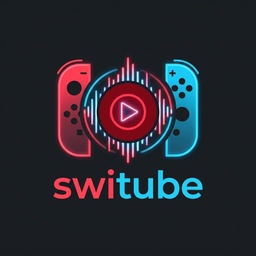

# Switube

### Cliente Nativo de YouTube Music y Motor de Audio en Segundo Plano para Nintendo Switch

[](https://github.com/dl3g0/Switube)
[](https://github.com/dl3g0/Switube)
[](https://github.com/dl3g0/Switube)
[](https://github.com/dl3g0/Switube)
[](LICENSE)

<p align="center">
  <b>Switube</b> lleva la experiencia completa de <b>YouTube Music</b> directamente a tu Nintendo Switch sin necesidad de cuenta Premium ni emparejamiento externo.<br/>
  Disfruta de una aplicación de pantalla completa con <b>descargas offline</b> y de un <b>overlay ultraligero</b> que reproduce tu música favorita en segundo plano mientras juegas.
</p>

[Características](#-características-principales) •
[Galería](#-galería) •
[Controles](#-controles) •
[Instalación](#-instalación-en-la-microsd) •
[Segundo Plano](#-cómo-reproducir-música-en-segundo-plano) •
[FAQ](#-preguntas-frecuentes-faq) •
[Arquitectura](#-arquitectura-del-proyecto) •
[Compilación](#-compilación-desde-el-código-fuente) •
[Créditos](#-créditos-y-agradecimientos)

</div>

---

## 🎯 Dos Experiencias Integradas

Switube está compuesto por dos módulos diseñados para funcionar tanto de forma dedicada como mientras juegas a cualquier título de Nintendo Switch:

| Componente | Archivo | Propósito |
| :--- | :--- | :--- |
| **Switube App** | `Switube.nro` | Aplicación principal a pantalla completa construida sobre **Borealis**. Incluye feed de Inicio dinámico, Búsqueda avanzada con filtros, perfiles de Artista, Álbumes, Sencillos, Playlists y **gestor de descargas offline**. |
| **Switube Overlay + Sysmodule** | `Switube.ovl` + `exefs.nsp` | Reproductor ligero para **Ultrahand / Tesla** respaldado por un servicio de sistema de Atmosphère (`0x4200000000535755`) con una huella de memoria ultrabaja (~10 MB) para escuchar música **dentro de tus juegos**. |

---

## ✨ Características Principales

### 🖥️ Aplicación Principal (`Switube.nro`)
- **Cuenta Oficial de YouTube Music (QR Login):** Vincula tu cuenta mediante código QR (`Google TV OAuth 2.0`) desde *Ajustes* para sincronizar tus **Me gusta**, **Playlists**, álbumes guardados y recomendaciones personalizadas en *Inicio*.
- **Feed de Inicio Dinámico (Multi-Carrusel):** Carga automática de múltiples secciones de YouTube Music (*Selección rápida*, *Clásicos inolvidables*, *Nuevos lanzamientos*, *Tendencias*, etc.) con paginación infinita por scroll.
- **Búsqueda con Filtros Inteligentes:** Explora el catálogo completo de YouTube Music filtrando por **Todos**, **Canciones**, **Videos**, **Álbumes**, **Artistas** y **Listas de reproducción** con carga continua automática.
- **Vistas Dedicadas de Artistas y Colecciones:** Consulta la biografía, suscriptores, canciones populares, discografía (álbumes y sencillos) y artistas similares, o abre cualquier álbum, sencillo o lista de reproducción.
- **Descargas Offline Nativas (`.opus`):**
  - Descarga cualquier canción o video con un solo botón para escucharla **sin conexión a Internet**.
  - Las pistas se almacenan en `/config/Switube/downloads/` junto con su índice de metadatos (`downloads.json`), listas para reproducirse al instante tanto en la app como desde el overlay.
- **Interfaz Obsidiana/Carmesí y MiniPlayer Flotante:**
  - Barra lateral translúcida redondeada, *MiniPlayer* flotante tipo cristal con barra de progreso en vivo, y vista *En Reproducción* en card flotante con carátula HD ambiental y botón de *Me gusta* (`♥`/`♡`).
- **Auto-Actualizador Integrado:** Comprueba nuevas versiones en GitHub Releases al iniciar o desde *Ajustes*, consulta el historial de cambios y descarga/instala el paquete `Switube-Complete-SD.zip` directamente desde la consola.
- **Multilenguaje Automático:** Detección automática del idioma del sistema de la consola (**Español** / **Inglés**) con selector en vivo desde *Ajustes*.

### 🎮 Overlay y Motor en Segundo Plano (`Switube.ovl` + `exefs.nsp`)
- **Música Mientras Juegas:** Reproduce pistas descargadas o transmite directamente desde YouTube Music sin salir de tu partida.
- **Huella de Memoria Optimizada (~10 MB):** El sysmodule (`0x4200000000535755`) utiliza un compilado a medida de **FFmpeg** (únicamente demuxers `matroska/webm`, `mov/mp4`, `ogg` y decodificadores `opus` y `aac`) y adquiere `audout` bajo demanda solo cuando hay audio activo.
- **Navegación Completa en el Overlay:**
  - **En Reproducción:** Tarjeta interactiva con barra de progreso, controles de transporte (**Repetir**, **Anterior**, **Play/Pausa**, **Siguiente**, **Aleatorio**) y deslizador de volumen.
  - **Descargas Offline:** Acceso instantáneo a todas las canciones descargadas desde la app principal.
  - **Buscar en YouTube Music:** Teclado integrado en el overlay para buscar y reproducir cualquier canción en línea al vuelo.

---

## 📸 Galería

| Inicio | Reproduciendo con MiniPlayer |
| :---: | :---: |
| 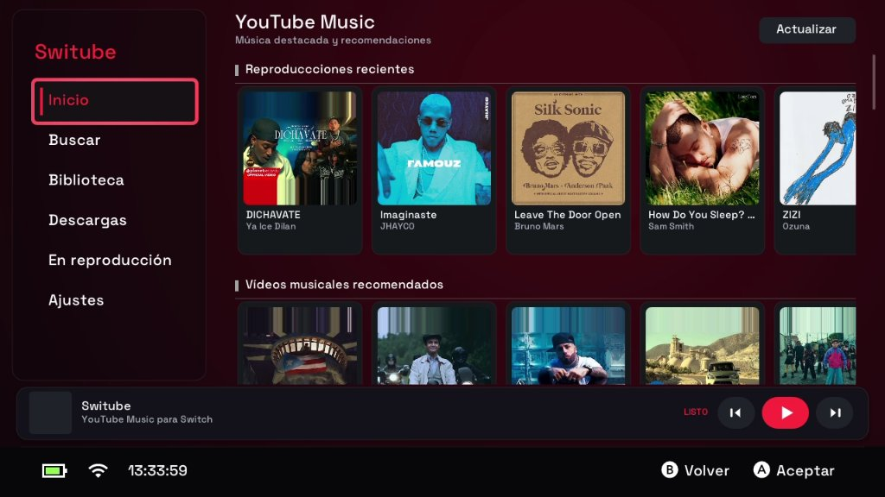 | 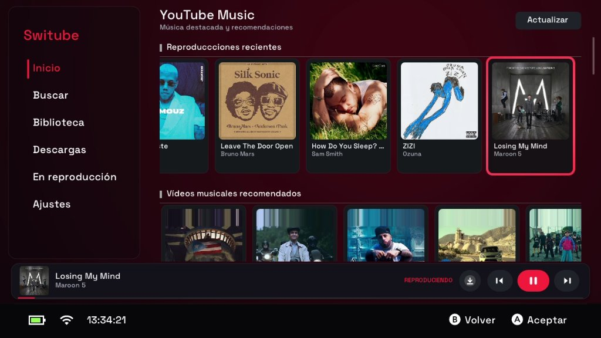 |

| En Reproducción | Biblioteca Sincronizada |
| :---: | :---: |
| 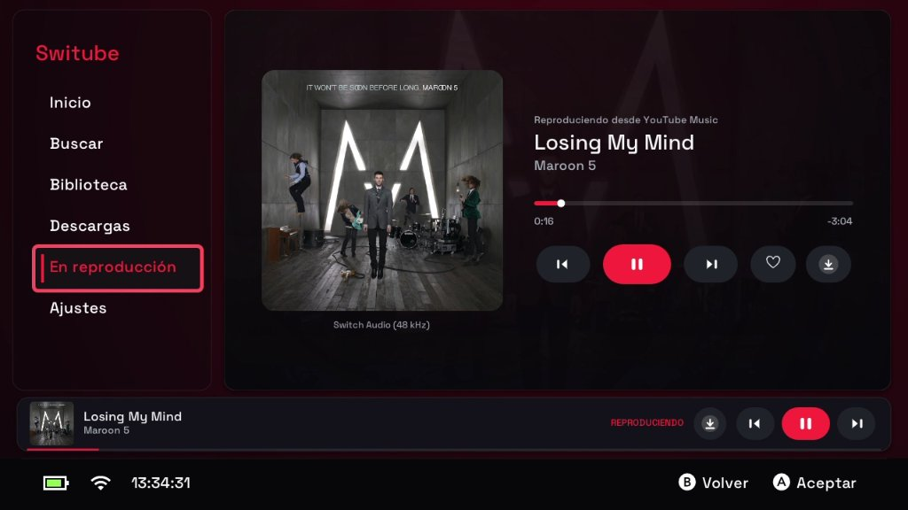 | 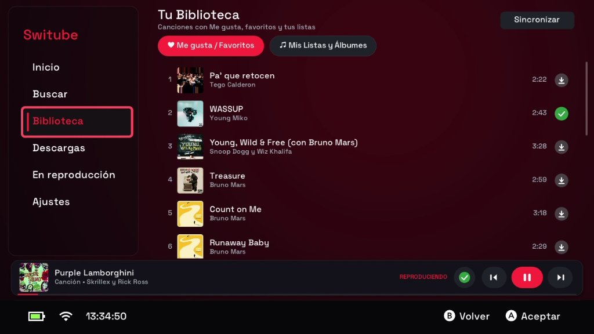 |

| Descargas Offline | Ajustes (Cuenta, Idioma y Updates) |
| :---: | :---: |
| 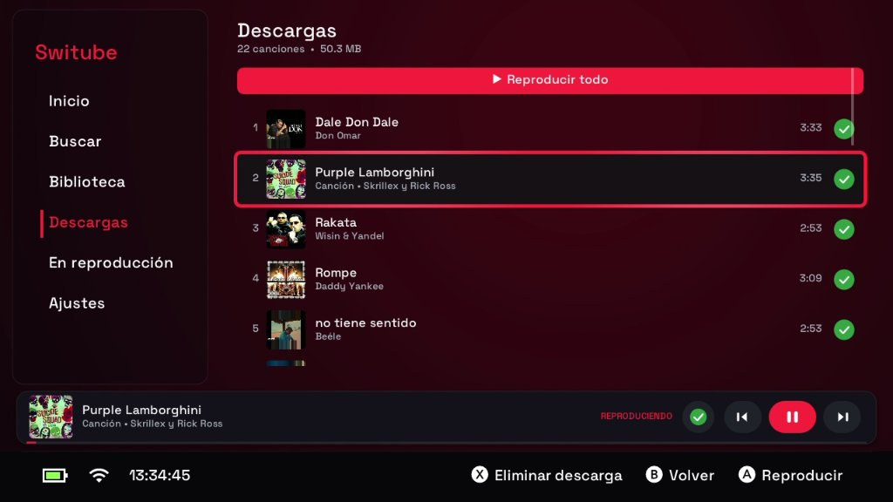 | 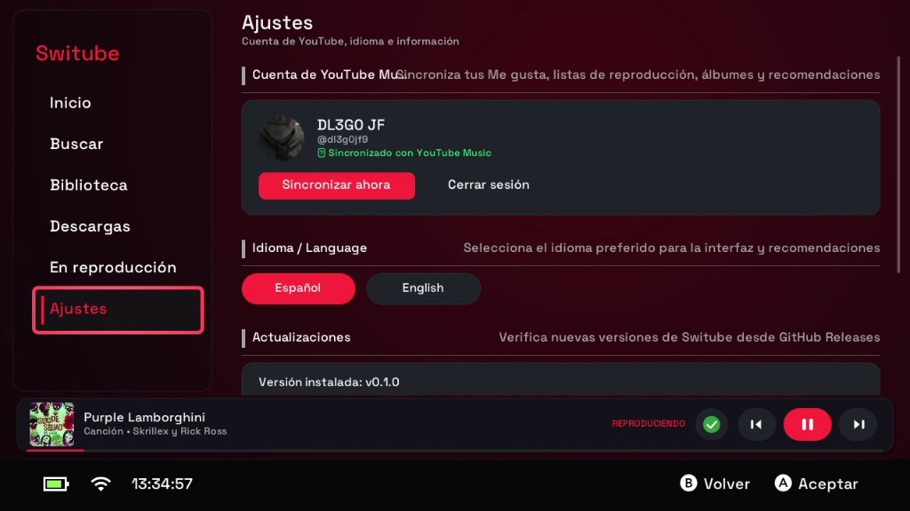 |

| Menú Ultrahand | Overlay en Segundo Plano |
| :---: | :---: |
| 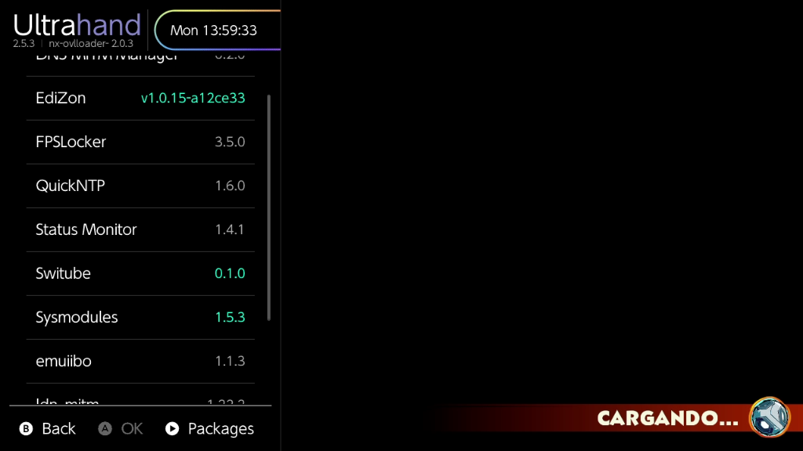 | 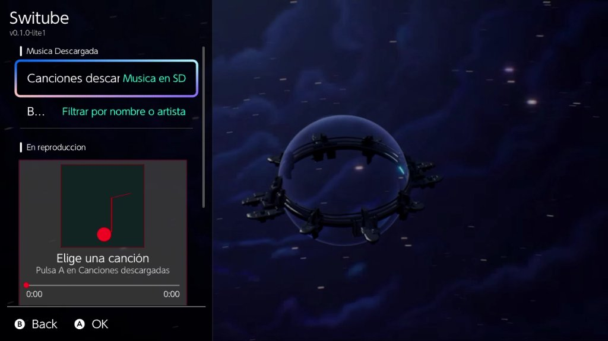 |

| Descargas en Juego (Overlay) | Reproduciendo en Juego (Overlay) |
| :---: | :---: |
| 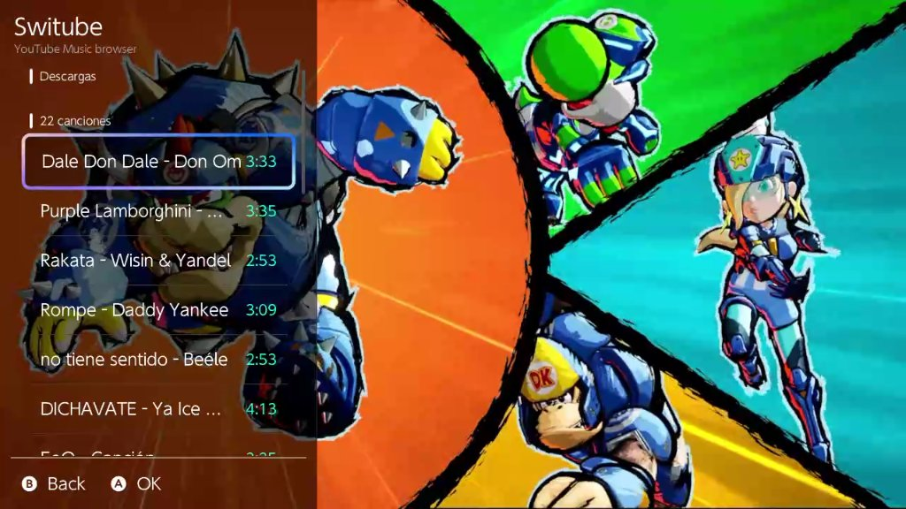 | 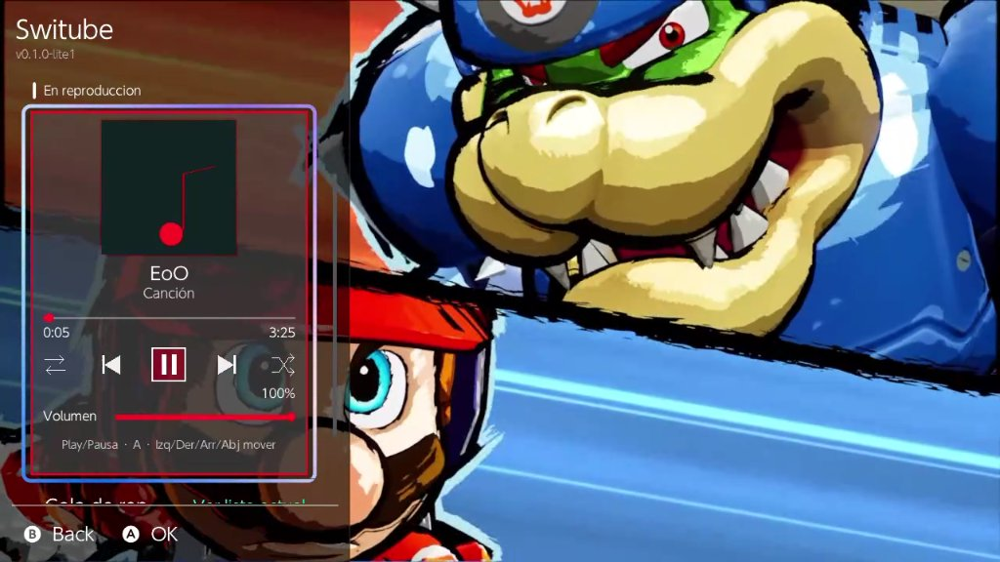 |

---

## 🎮 Controles

### En la Aplicación Principal (`Switube.nro`)

| Botón | Acción |
| :---: | :--- |
| **D-Pad / Stick Izquierdo** | Navegar por pestañas, carruseles, filas de canciones y controles |
| **A** | Reproducir canción / Video • Abrir Álbum, Sencillo, Artista o Lista |
| **X** *(sobre una canción/video)* | **Descargar canción** para modo offline / **Eliminar descarga** |
| **B** | Volver atrás |
| **Y** | Play / Pausa rápida desde cualquier pantalla *(o Me gusta en En Reproducción)* |
| **L / R** | Canción Anterior / Siguiente |
| **ZL / ZR** | Bajar / Subir volumen |
| **Pantalla Táctil** | Toque directo sobre tarjetas, botones, barra de progreso e íconos de descarga |

### En el Overlay (`Switube.ovl` — Vista *En Reproducción*)

| Botón | Acción |
| :---: | :--- |
| **L + D-Pad Abajo + R3** | Abrir / Cerrar el menú de Ultrahand / Tesla |
| **▲ / ▼** *(D-Pad o Sticks)* | Cambiar entre **Barra de Progreso**, **Botones de Transporte**, **Volumen** y **Cola** |
| **◀ / ▶** *(en Progreso)* | Retroceder / Adelantar **±10 segundos** (admite mantener presionado) |
| **◀ / ▶ + A** *(en Transporte)* | Seleccionar y activar **Repetir**, **Anterior**, **Play/Pausa**, **Siguiente** o **Aleatorio** |
| **◀ / ▶** *(en Volumen)* | Bajar / Subir volumen de **5% en 5%** (admite mantener presionado) |
| **L / R** | Atajo directo a Canción Anterior / Siguiente |
| **X / Y** | Atajo directo a Modo Aleatorio (`X`) y Repetir (`Y`) |
| **Pantalla Táctil** | Toque directo sobre los 5 botones de transporte, barra de tiempo o barra de volumen |

---

## 📦 Instalación en la microSD

1. Descarga el paquete `Switube-Complete-SD.zip` y extrae su contenido directamente en la **raíz de tu tarjeta microSD**.
2. Verifica que la estructura de archivos en tu microSD quede de la siguiente manera:

```text
sdmc:/
├── atmosphere/
│   └── contents/
│       └── 4200000000535755/
│           ├── exefs.nsp          # Motor de audio en segundo plano (Sysmodule)
│           └── toolbox.json       # Configuración para Hekate Toolbox / Kosmos
├── switch/
│   ├── .overlays/
│   │   └── Switube.ovl            # Overlay para Ultrahand / Tesla
│   └── Switube/
│       └── Switube.nro            # Aplicación principal a pantalla completa
└── config/
    └── Switube/
        └── downloads/             # Carpeta donde se guardan tus canciones offline (.opus)
```

3. **Para usar la Aplicación Principal (`Switube.nro`):**
   - Se recomienda abrirla mediante **Title Override** para disponer de toda la memoria RAM de la consola: mantén presionado **`R`** mientras abres cualquier juego hasta que aparezca el *Homebrew Menu*, y lanza **Switube**.
4. **Para usar el Overlay (`Switube.ovl`):**
   - Abre el menú de **Ultrahand / Tesla** (`L + D-Pad Abajo + Stick Derecho`) en cualquier momento y selecciona **Switube**. El sysmodule se iniciará automáticamente bajo demanda.

---

## 🎧 Cómo reproducir música en segundo plano

Sigue estos pasos para escuchar música mientras juegas cualquier título en tu Nintendo Switch usando **Ultrahand / Tesla**:

1. **Prepara los archivos en la microSD:**
   - Asegúrate de haber extraído `Switube-Complete-SD.zip` en la raíz de tu microSD, verificando que existan:
     - `sdmc:/atmosphere/contents/4200000000535755/exefs.nsp` y `toolbox.json`
     - `sdmc:/switch/.overlays/Switube.ovl`
2. **Verifica que tengas System RAM libre (~4.5 MB o más):**
   - Abre **Ultrahand** (`L + D-Pad Abajo + R3`) y entra a **Sysmodules**.
   - El sysmodule de Switube necesita aproximadamente **~3.5 – 4.5 MB** de *System RAM* (heap de 1.5 MB + binario + buffers).
   - Si tienes otros sysmodules activos al mismo tiempo (como `SysDVR`, `MissionControl`, `sys-con` o `SaltyNX`) y ves menos de **5 MB libres**, apaga temporalmente alguno que no estés usando en esa partida (por ejemplo `SysDVR`).
3. ***(Opcional)* Descarga canciones para modo offline:**
   - Entra a la app principal **`Switube.nro`** (recomendado con *Title Override*) y pulsa **`X`** sobre cualquier canción para guardarla en `sdmc:/config/Switube/downloads/`. Así podrás reproducirla al instante incluso sin Wi-Fi.
4. **Inicia la música desde tu juego:**
   - Abre tu juego favorito (o quédate en el menú HOME).
   - Abre **Ultrahand** con **`L + D-Pad Abajo + R3`** y selecciona **Switube**.
   - Elige **Canciones descargadas** (offline) o **Buscar en YouTube Music** (streaming en línea) y pulsa **`A`** para reproducir.
   - Cierra el overlay con **`B`**: la música seguirá sonando en segundo plano mientras juegas y podrás volver a abrirlo en cualquier momento para pausar, cambiar de canción o ajustar el volumen.

---

## ❓ Preguntas Frecuentes (FAQ)

<details>
<summary><b>¿Necesito una cuenta de YouTube Premium para usar Switube?</b></summary>
<br/>
No. Switube funciona de forma gratuita sin suscripción Premium. Además, desde la pestaña <b>Ajustes</b> puedes vincular tu cuenta normal de YouTube Music mediante código QR para sincronizar tus <i>Me gusta</i>, listas de reproducción y recomendaciones.
</details>

<details>
<summary><b>El sysmodule de Switube aparece en "Off" o no se activa en Ultrahand → Sysmodules</b></summary>
<br/>
Casi siempre ocurre por falta de <b>System RAM</b> libre. Atmosphère reserva un espacio muy limitado para sysmodules; si tienes activos simultáneamente <code>SysDVR</code>, <code>sys-con</code>, <code>MissionControl</code> y <code>SaltyNX</code>, la memoria libre puede bajar de ~4.5 MB y el sistema impedirá iniciar Switube. Apaga temporalmente alguno de los otros sysmodules (especialmente <code>SysDVR</code>) e inténtalo de nuevo.
</details>

<details>
<summary><b>¿Debo activar "Auto Start" para el sysmodule?</b></summary>
<br/>
No es obligatorio. Dejar <i>Auto Start</i> desactivado evita ocupar ~4 MB de System RAM cuando no estás escuchando música; el overlay o el toggle de Sysmodules lo iniciarán cuando lo necesites.
</details>

<details>
<summary><b>¿Por qué se recomienda abrir Switube.nro con Title Override?</b></summary>
<br/>
El <i>Applet Mode</i> (abrir el Álbum sin mantener <code>R</code>) limita la memoria RAM disponible para la aplicación. Al mantener presionado <b>R</b> sobre cualquier juego hasta entrar al Homebrew Menu, <code>Switube.nro</code> dispone de toda la RAM de la consola para navegar fluidamente, cachear portadas HD y descargar canciones sin problemas.
</details>

<details>
<summary><b>¿Cómo actualizo Switube a una nueva versión?</b></summary>
<br/>
Switube incluye un auto-actualizador en <b>Ajustes → Actualizaciones → Buscar actualizaciones</b> (y también comprueba silenciosamente al iniciar). Descarga automáticamente <code>Switube-Complete-SD.zip</code> desde GitHub Releases, actualiza el overlay/sysmodule en la microSD y aplica el nuevo <code>Switube.nro</code> al reiniciar la app.
</details>

<details>
<summary><b>¿Dónde se guardan las descargas, la sesión vinculada y los logs?</b></summary>
<br/>
Todo se almacena dentro de <code>sdmc:/config/Switube/</code>:
<ul>
  <li><b>Canciones offline:</b> <code>/config/Switube/downloads/</code></li>
  <li><b>Sesión vinculada (OAuth):</b> <code>/config/Switube/auth.json</code></li>
  <li><b>Registro de diagnóstico (log):</b> <code>/config/Switube/app.log</code></li>
</ul>
</details>

---

## 🏗️ Arquitectura del Proyecto

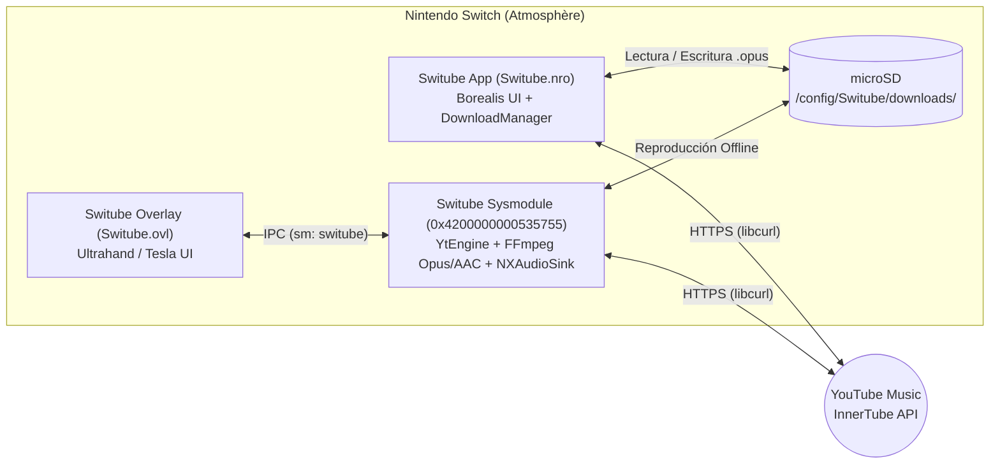

### Estructura del Repositorio

```text
Switube/
├── app/                        # Aplicación principal (Borealis)
│   ├── resources/              # Fuentes, iconos, vistas XML e i18n
│   └── src/                    # Cliente InnerTube, reproductor FFmpeg, DownloadManager y vistas UI
├── phase2/                     # Motor de segundo plano e integración con Tesla/Ultrahand
│   ├── common/                 # Definición del protocolo IPC y estructuras compartidas
│   ├── ipc-client/             # Cliente IPC ligero en C para el overlay
│   ├── overlay/                # Código fuente del overlay (libultrahand / libtesla)
│   └── sysmodule/              # Servicio de Atmosphère (0x4200000000535755) y stubs FFmpeg
├── targets/switch/             # Salida de audio nativa NXAudioSink (audout) y NXConsoleLog
├── vendor/                     # Dependencias incluidas (Borealis y nlohmann/json)
├── build-app.ps1               # Script de compilación para Switube.nro
├── build-phase2.ps1            # Script de compilación para exefs.nsp + Switube.ovl
└── package_sd.ps1              # Empaquetador automático de Switube-Complete-SD.zip
```

---

## 🛠️ Compilación desde el Código Fuente

### Requisitos Previos
- **Windows PowerShell**
- **devkitPro** instalado en `C:\devkitPro` con los paquetes:
  ```bash
  pacman -S switch-dev switch-cmake switch-curl switch-ffmpeg switch-mbedtls switch-zlib switch-bzip2 switch-dav1d
  ```

### Pasos de Compilación

1. **Compilar la aplicación principal (`Switube.nro`):**
   ```powershell
   .\build-app.ps1
   ```
2. **Compilar el sysmodule en segundo plano y el overlay (`exefs.nsp` + `Switube.ovl`):**
   ```powershell
   .\build-phase2.ps1
   ```
3. **Generar el paquete completo para microSD (`Switube-Complete-SD.zip`):**
   ```powershell
   .\package_sd.ps1
   ```

*(Consulta [BUILDING.md](BUILDING.md) para más detalles sobre despliegue rápido por red mediante `nxlink` o FTP).*

---

## 🙌 Créditos y Agradecimientos

Este proyecto ha sido posible gracias al trabajo de la comunidad de escena de Nintendo Switch:

- **[Switify](https://github.com/DomazinUS/Switify)** (*HiroshiYamauchi*) — Créditos especiales por el **diseño de la interfaz de usuario (UI)**, el sistema de componentes visuales en Borealis y la estructura visual del overlay.
- **BitChord** — Créditos especiales por la **inspiración y referencia técnica** en el manejo de consultas, filtros y exploración de YouTube Music (InnerTube) en Nintendo Switch.
- **[Borealis](https://github.com/natinusala/borealis)** (*natinusala*, *XITRIX* y colaboradores) — Framework de interfaz gráfica acelerada por hardware con soporte de mando y pantalla táctil para Nintendo Switch.
- **[libultrahand](https://github.com/ppkantorski/libultrahand) / libtesla** (*ppkantorski*, *WerWolv*) — Librerías base para el desarrollo del overlay.
- **[devkitPro](https://devkitpro.org/) / libnx / FFmpeg** — Toolchain, librerías del sistema Horizon OS y decodificación de audio.

---

## 📄 Licencia

Distribuido bajo la licencia **GNU General Public License v3.0 o posterior** (`GPL-3.0-or-later`). Consulta los archivos [LICENSE](LICENSE) y [THIRD_PARTY_NOTICES.md](THIRD_PARTY_NOTICES.md) para más información.
