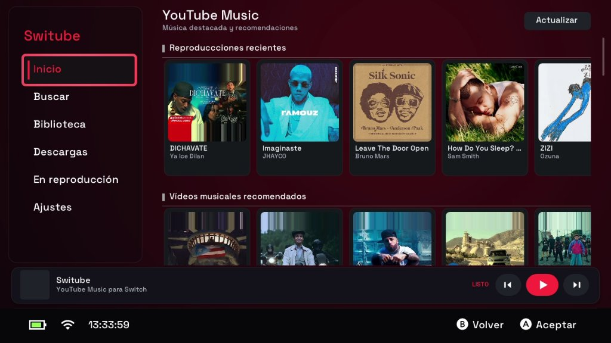
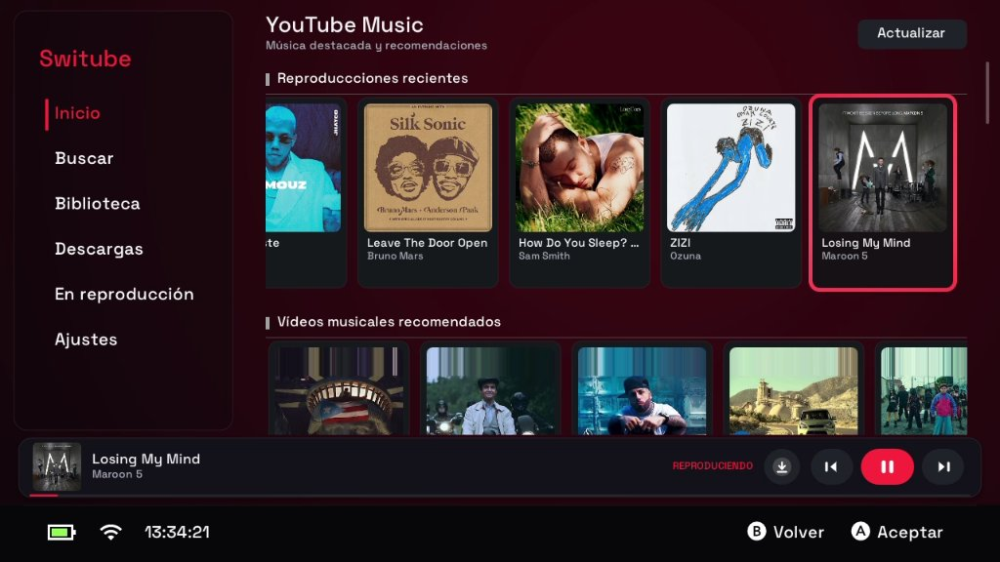
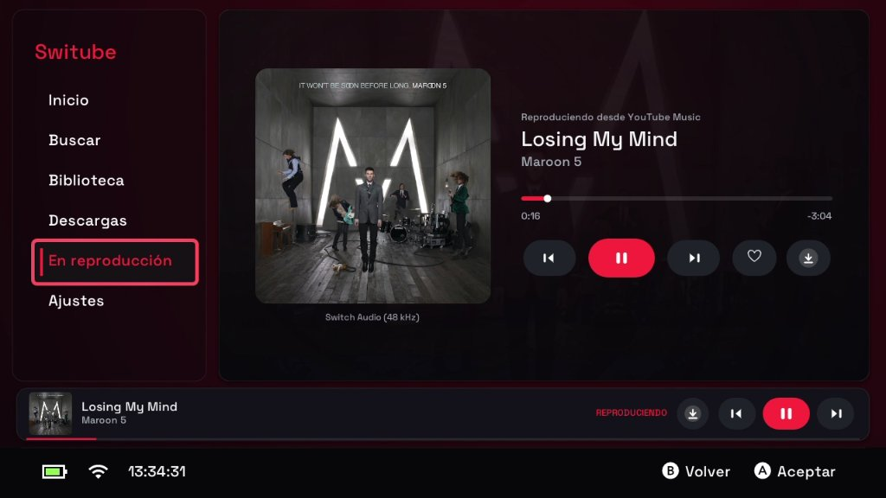
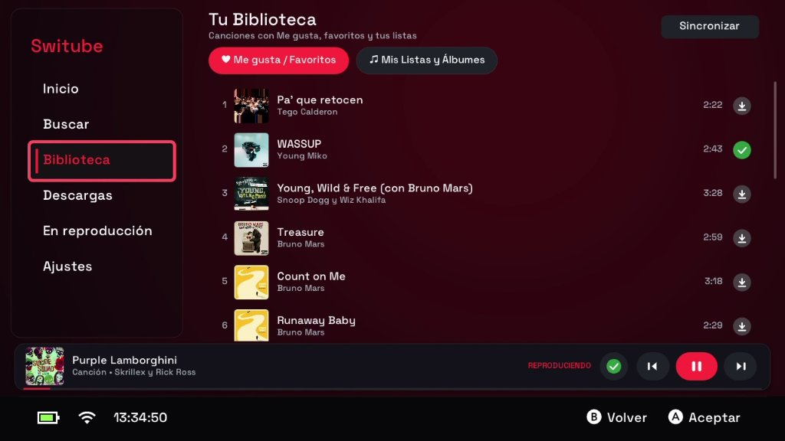
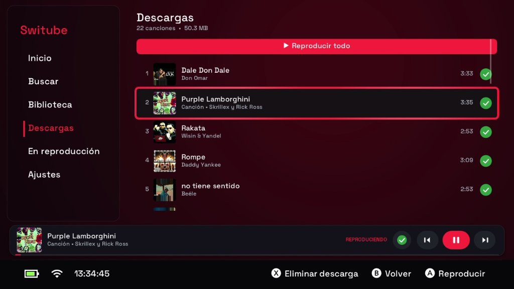
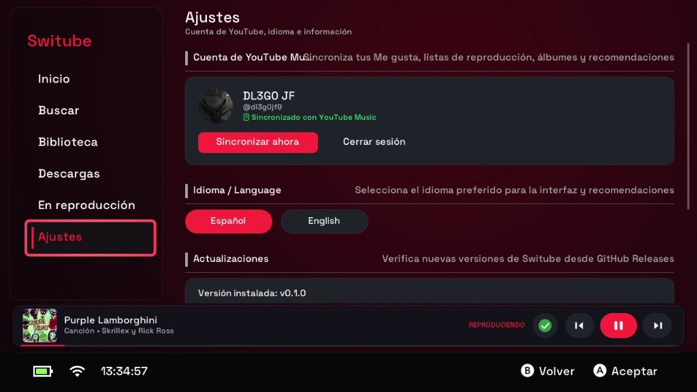
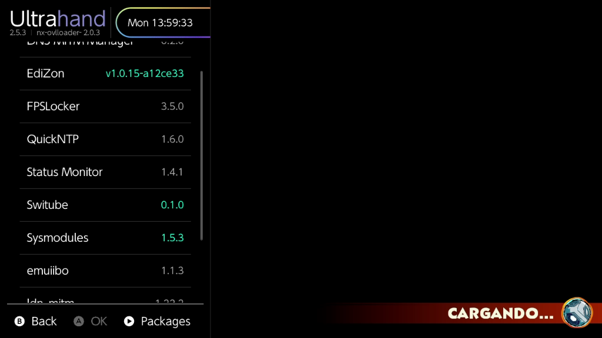
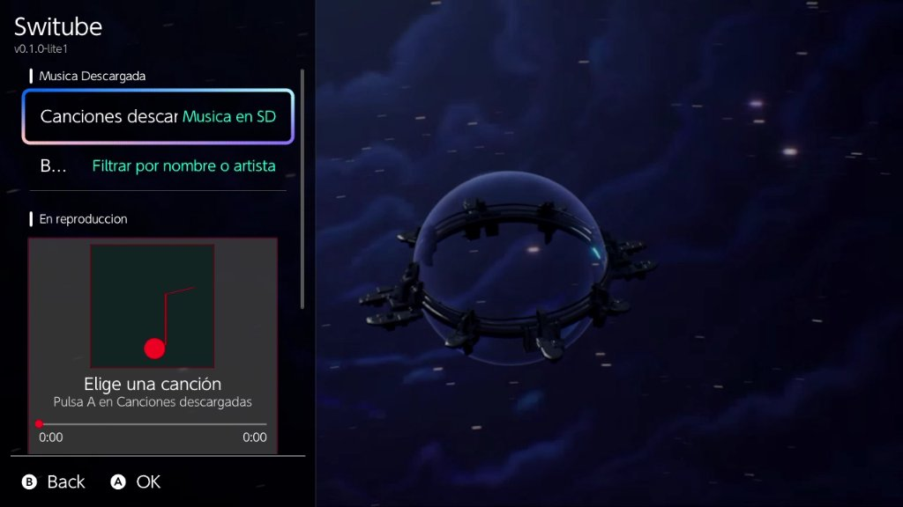

# 🚀 Switube v0.2.0 — Sincronización con Cuenta, Auto-Actualizador y Rediseño UI/UX

Esta actualización **v0.2.0** introduce vinculación oficial con tu cuenta de YouTube Music mediante código QR, sincronización completa de biblioteca, paginación infinita, auto-actualizador desde GitHub Releases, un rediseño visual completo en estilo obsidiana/carmesí y múltiples correcciones críticas de estabilidad.

---

## ✨ Novedades de la Versión 0.2.0

### 🔐 Cuenta de YouTube Music y Sincronización
- **Vinculación por Código QR (Google TV OAuth 2.0):** Escanea el código QR desde *Ajustes* (`google.com/device` / `youtube.com/activate`) para iniciar sesión sin contraseñas en la consola. La sesión se guarda en `/config/Switube/auth.json`.
- **Sincronización de Biblioteca:** Carga automática de tus canciones con **Me gusta** (`VLLM`), listas de reproducción y álbumes guardados en *Biblioteca*, además de recomendaciones personalizadas en *Inicio*.
- **Me gusta bidireccional:** Botón interactivo `♥` / `♡` en *En reproducción* (y atajo con **`Y`**) sincronizado en tiempo real con tu cuenta.

### 🎨 Rediseño UI/UX y Portadas HD
- **Tema Unificado Obsidiana & Carmesí:** Eliminadas las barras grises y el foco cian por defecto de Borealis; ahora la barra lateral es un card translúcido redondeado, el footer inferior es negro obsidiana (`#07070A`) y el foco usa tonos carmesí/coral.
- **MiniPlayer Flotante y Card *En Reproducción*:**
  - *MiniPlayer* rediseñado como cápsula flotante tipo cristal con sombra suave, borde de `1px` y barra de progreso en vivo en el borde inferior.
  - Vista *En Reproducción* convertida en un card flotante redondeado con carátula ambiental centrada y degradado interno sin cortes bruscos.
- **Portadas en Alta Resolución y Carga Rápida:** Escalado automático de miniaturas (`360px` en tarjetas, `240px` en filas/MiniPlayer, `544px` en *En reproducción* y `/hqdefault.jpg` para `i.ytimg.com`) con pool de 4 hilos y reutilización de conexiones `CURL*`.

### 🔄 Auto-Actualizador y Paginación Infinita
- **Actualizador Integrado (GitHub Releases):** Comprobación silenciosa al iniciar y manual desde *Ajustes* (con visor scrollable de *Changelog*), descarga automática de `Switube-Complete-SD.zip` (extrayendo `.nro`, `.ovl` y sysmodule con `minizip`) y aplicación segura al reiniciar.
- **Scroll Infinito:** Paginación automática al desplazarse o acercarse al final en *Inicio*, *Buscar*, *Biblioteca* (Favoritos y Playlists) y listas/álbumes.

### 🛠️ Correcciones de Estabilidad
- **Fix de crash Use-After-Free al navegar con joystick:** Corregidos los botones de transporte (`makePlayPauseButton`, `makePrevButton`, `makeNextButton`) y añadida limpieza segura de foco (`safeClearViews` / `safeRemoveView`) al actualizar listas dinámicas.
- **Fix de congelamiento al pausar tras avanzar pista:** Timeout acotado en `audoutWaitPlayFinish`, liberación de `sinkMutex_` en operaciones atómicas y transición segura en `playPause()`.
- **Fix de errores SSL en streaming e *Inicio*:** Limitado `CURLOPT_MAXCONNECTS = 1L` por hilo de imágenes para evitar el agotamiento de sockets BSD/TLS en Switch, además de límite de reintentos consecutivos en `YtEngine`.
- **Pulido general:** Eliminado el glifo roto `?` en botones de sincronización, corregido el subtítulo duplicado en *Inicio* y ocultadas las opciones de `Seek` del menú inferior en *En reproducción*.

### 📸 Galería de v0.2.0

| Inicio | Reproduciendo con MiniPlayer |
| :---: | :---: |
|  |  |

| En Reproducción | Biblioteca Sincronizada |
| :---: | :---: |
|  |  |

| Descargas Offline | Ajustes (Cuenta, Idioma y Updates) |
| :---: | :---: |
|  |  |

| Menú Ultrahand | Overlay en Segundo Plano |
| :---: | :---: |
|  |  |

---

# 🚀 Switube v0.1.0 — Lanzamiento Inicial

**Switube** es un cliente nativo de **YouTube Music** y motor de reproducción en segundo plano para **Nintendo Switch**, diseñado para funcionar sin necesidad de cuenta Premium ni emparejamiento con dispositivos externos.

Esta versión inicial **v0.1.0** incluye tanto la aplicación principal a pantalla completa (**`Switube.nro`**) como el paquete de reproducción en segundo plano para **Ultrahand / Tesla** (**`Switube.ovl` + `exefs.nsp`**).

---

## ✨ Novedades de la Versión 0.1.0

### 🖥️ Aplicación Principal (`Switube.nro`)
- **Interfaz Nativa en Borealis:** Navegación fluida con mando (D-Pad y Sticks) y soporte completo para pantalla táctil.
- **Inicio Dinámico Multi-Carrusel:** Carga automática de secciones personalizadas y globales de YouTube Music (*Selección rápida*, *Clásicos inolvidables*, *Esenciales de todos los tiempos*, *Nuevos lanzamientos*, *Canciones del momento para ti*, *Playlists de la comunidad*, *Álbumes y sencillos nuevos*, *Tendencias* y *Videos musicales nuevos*).
- **Búsqueda Avanzada con Filtros:** Búsqueda en tiempo real con chips de filtro por categoría (**Todos**, **Canciones**, **Videos**, **Álbumes**, **Artistas** y **Listas de reproducción**) y paginación continua (*Cargar más*).
- **Perfiles de Artista, Álbumes, Sencillos y Playlists:**
  - Vista de artista con foto de cabecera, suscriptores, canciones populares, discografía (álbumes/sencillos) y artistas relacionados.
  - Vista completa para álbumes, sencillos (*Singles / EPs*) y listas de reproducción con reproducción de cola completa.
- **Modo Offline y Gestor de Descargas (`.opus`):**
  - Descarga canciones y videos directamente desde cualquier lista (botón **`X`** al enfocar una pista), desde la barra lateral o desde la vista *En Reproducción*.
  - Almacenamiento local en `sdmc:/config/Switube/downloads/` con reproducción instantánea sin conexión a Internet.
- **Reproductor Completo y Mini-Player:**
  - Controles de transporte completos (*Play/Pausa*, *Anterior*, *Siguiente*, *Aleatorio / Shuffle*, *Repetir Todo / Una*), barra de progreso interactiva (±10 s) y control de volumen.
  - Audio nativo en alta calidad **Opus / AAC a 48 kHz** mediante `audout`.
- **Soporte Multilenguaje:** Detección automática del idioma de la consola (**Español** / **Inglés**) y cambio en caliente desde la pestaña *Ajustes*.

---

### 🎮 Overlay y Motor en Segundo Plano (`Switube.ovl` + `exefs.nsp`)
- **Música Mientras Juegas:** Escucha tus canciones descargadas o transmite directamente desde YouTube Music sin salir de tus juegos.
- **Sysmodule Ultraligero (`0x4200000000535755`):**
  - Huella de memoria reducida (~10 MB) con compilación minimalista de **FFmpeg** (demuxers `webm/matroska`, `mp4/mov`, `ogg` y decodificadores `opus` y `aac`) para total compatibilidad con los juegos de Nintendo Switch.
  - Adquisición diferida de `audout`: el servicio no reserva recursos de audio hasta que inicia la reproducción.
- **Overlay Interactivo para Ultrahand / Tesla:**
  - **Vista *En Reproducción*:** Navegación por zonas con D-Pad, Sticks o pantalla táctil sobre la barra de tiempo (±10 s), los 5 botones de transporte (*Repetir*, *Anterior*, *Play/Pausa*, *Siguiente*, *Aleatorio*) y la barra de volumen (pasos de 5%).
  - **Descargas Offline:** Reproduce al instante cualquier canción descargada previamente desde la aplicación principal.
  - **Búsqueda en Línea:** Teclado integrado en el overlay para buscar y reproducir pistas de YouTube Music en cualquier momento.

---

## 📦 Archivos de la Release e Instalación

Descarga **`Switube-Complete-SD.zip`** y extrae su contenido directamente en la **raíz de tu tarjeta microSD**:

| Ruta en la microSD | Descripción |
| :--- | :--- |
| `/switch/Switube/Switube.nro` | Aplicación principal a pantalla completa |
| `/switch/.overlays/Switube.ovl` | Overlay para Ultrahand / Tesla |
| `/atmosphere/contents/4200000000535755/exefs.nsp` | Sysmodule de audio en segundo plano |
| `/atmosphere/contents/4200000000535755/toolbox.json` | Configuración para Hekate Toolbox / Kosmos |

> **Recomendación:** Inicia la aplicación principal (`Switube.nro`) usando **Title Override** (manteniendo presionado **`R`** al abrir cualquier juego hasta entrar al *Homebrew Menu*) para disponer de toda la memoria RAM del sistema.

---

## 🙌 Créditos

- **[Switify](https://github.com/DomazinUS/Switify)** (*HiroshiYamauchi*) — Por el diseño de la interfaz de usuario e infraestructura visual en Borealis y el overlay.
- **BitChord** — Por la inspiración y referencia técnica en la integración con YouTube Music (InnerTube) en Nintendo Switch.
- **[Borealis](https://github.com/natinusala/borealis)** & **[libultrahand](https://github.com/ppkantorski/libultrahand) / libtesla** — Frameworks de interfaz gráfica y overlay para Nintendo Switch.
